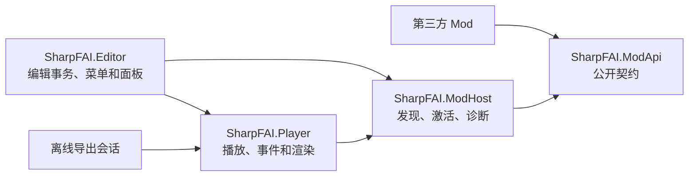

# SharpFAI Mod API 设计

**状态：设计提案** · **首个兼容契约：Mod API 1.0** · **首发平台：Windows、macOS、Linux 桌面版**

## 1. 目标与范围

为 SharpFAI 编辑器、独立播放器和离线视频导出提供共用的扩展契约。典型 Mod 包括谱面检查、批量编辑、快捷键、统计 HUD、自定义事件、摄像机效果、后处理和素材导出。仅在安装并启用 Mod 后加载它的代码。普通谱面和官方事件继续走现有流程。

| 扩展点 | 编辑器 | 播放器 | 离线导出 | 阶段 |
| --- | --- | --- | --- | --- |
| 读取谱面、检查问题、查找砖块 | ✓ | — | — | 1 |
| 命令、菜单、快捷键、设置面板、编辑事务 | ✓ | 可加播放器命令 | — | 1 |
| 时间、播放控制、判定观察、预览 HUD | ✓ | ✓ | 按类型可用 | 2 |
| 自定义事件字段、按时间求值、基础场景效果 | ✓ | ✓ | ✓ | 2 |
| 场景绘制、后处理、音频处理、导出器扩展 | ✓ | ✓ | 按能力声明 | 3 |
| Android、独立脚本宿主、在线分发 | 预留 | 预留 | — | 后续评估 |

首版以桌面 .NET 10 托管 Mod 为主。内建事件实现、渲染器和序列化器继续由 SharpFAI 维护。公开契约通过宿主服务授予能力，补丁式修改方法和替换内部对象不属于兼容契约。

## 2. 项目边界



| 模块 | 职责 |
| --- | --- |
| `SharpFAI.ModApi` | SDK NuGet 包。包含生命周期、数据记录、类型化能力接口和稳定错误码。目标框架 `net10.0`，只依赖 BCL |
| `SharpFAI.ModHost` | 发现、验证、加载、会话实例、能力注册、诊断和资源回收。由主应用分发 |
| 编辑器适配层 | 将编辑请求接入 `EditorDocument`，把字段定义接入 `EditorCatalog`，把命令接入现有输入和菜单系统 |
| 播放器适配层 | 在 `PlaybackEventBinder` 之后编译扩展时间线，经 `LevelRenderer` 的会话与渲染阶段应用输出 |
| 导出适配层 | 通过独立的 `Export` 会话复用播放器能力，固定谱面、Mod 版本和有效配置 |

公开 API 使用不可变记录与只读视图。砖块、事件和渲染资源以值或宿主管理的句柄暴露。ImGui、OpenTK、Thrust、Newtonsoft `JObject`、OpenGL 对象 ID 和真实设备句柄属于实现细节。设置面板通过宿主提供的控件描述构建，统一处理键盘、输入法、语言与 Web Mirror。

现有接入点包括 [编辑事务](../SharpFAI.Editor/EditorDocument.cs)、[事件定义](../SharpFAI.Editor/EditorCatalog.cs)、[编辑预览修订](../SharpFAI.Player/Engine/LevelRenderer.EditorRevision.cs)、[事件绑定](../SharpFAI.Player/Engine/Events/PlaybackEventBinder.cs)、[渲染流程](../SharpFAI.Player/Engine/LevelRenderer.Rendering.cs) 和 [视频导出](../SharpFAI.Player/VideoExporter.cs)。

## 3. 包格式和发现

分发包使用 `.sharpfaimod`，内部为 ZIP。安装后按 `ModId/Version` 放入 SharpFAI 用户数据目录。同一会话每个 Mod ID 只激活一个版本。便携模式可显式指定用户数据根目录。普通谱面目录和导入的谱面 ZIP 只用于读取谱面和素材。

```text
com.example.chartlint.sharpfaimod
├── mod.json
├── assemblies/
│   ├── ChartLint.dll
│   └── ChartLint.deps.json
├── assets/
├── locales/
│   ├── en.json
│   └── zh-Hans.json
└── README.md
```

```json
{
  "manifestVersion": 1,
  "id": "com.example.chartlint",
  "name": "Chart Lint",
  "version": "1.0.0",
  "api": "[1.0.0,2.0.0)",
  "entryAssembly": "assemblies/ChartLint.dll",
  "entryType": "Example.ChartLintMod",
  "hosts": ["editor"],
  "requiredCapabilities": ["chart.read", "editor.commands"],
  "optionalCapabilities": ["editor.edit"],
  "dependencies": [],
  "platforms": ["win-x64", "osx-arm64", "osx-x64", "linux-x64"]
}
```

- `manifestVersion` 管包格式。Mod 版本、API 版本、宿主应用版本和 Mod 自定义事件字段版本各自演进。版本范围采用 NuGet 区间语法。ID 用小写反向域名，扩展 ID 以所属 Mod ID 加 `/` 为前缀。
- 支持本地依赖版本约束。激活前解析全部必需依赖并拓扑排序，无依赖关系时按 ID 序排序。找不到兼容版本或发生循环时标出具体冲突，并停用依赖链上受影响的 Mod。可选依赖通过服务可用性判断。跨 Mod 服务通过独立的共用契约或受版本约束的消息传递。
- 安装按「验证 → 解压到暂存目录 → 校验 → 原子登记」执行。验证条目路径、大小和数量、校验值、重复名以及链接。相同内容可复用。安装和激活是两个操作，启动时先读取清单、兼容性和用户的启用记录，再加载 DLL。
- 升级先登记新版本，再在下次启动切换。每次导出固定到启动导出时的安装版本与包摘要。启用记录按包摘要保存，新包内容需由用户重新信任。卸载版本时可分别选择是否清理其用户设置。

## 4. 加载、信任与生命周期

每个 Mod 有一个可回收的 `AssemblyLoadContext`，用 `AssemblyDependencyResolver` 读取同目录的 `.deps.json`。ModApi 始终从默认上下文共享同一程序集实例，其余私有依赖优先从该 Mod 安装目录解析。开发模板将 SDK 设为仅编译引用。分发包不会带独立的共享 SDK DLL。宿主通过用户数据目录查找 Mod，适配现有单文件发布。 [.NET 插件加载](https://learn.microsoft.com/en-us/dotnet/core/tutorials/creating-app-with-plugin-support) · [.NET 单文件发布](https://learn.microsoft.com/en-us/dotnet/core/deploying/single-file/overview)

进程内 C# Mod 与宿主具有同等进程权限。`AssemblyLoadContext` 提供程序集依赖隔离，能力声明则描述宿主会授予哪些 API 服务。两者都无法约束 Mod 直接调用 .NET 的文件、网络和进程接口。启用页明确展示这一信任要求。谱面中的依赖提示、Web Mirror 会话和无人值守导出都不能授予新包信任。非可信代码应使用独立进程加操作系统隔离，该方案留待后续设计。 [.NET 加载上下文说明](https://learn.microsoft.com/en-us/dotnet/api/system.runtime.loader.assemblyloadcontext?view=net-10.0)

| 生命周期 | 宿主行为 |
| --- | --- |
| 发现 | 读取清单，显示禁用、缺依赖、API 不兼容或待信任状态。此时 DLL 尚未加载 |
| 激活 | 创建 Mod 实例并调用 `ActivateAsync`。注册在激活成功后统一生效，失败时清理该次注册 |
| 打开会话 | 按编辑、预览、游玩、离线导出模式创建会话作用域。每个会话独立持有取消令牌、挂载服务和状态 |
| 关闭会话 | 先停止通知与后台调度，再释放会话资源。释放 GPU 句柄的操作排到对应渲染线程 |
| 停用 | 取消 Mod 任务、注销命令和回调、调用 `DisposeAsync`，最后申请卸载上下文 |

正式版以重启作为安装更新、生效和彻底释放 DLL 的稳定边界。开发者模式可尝试热重载，通过弱引用验证上下文已回收。任务、委托或线程仍引用 Mod 时，界面显示「重启后完成」。插件卸载由运行时协作完成。 [.NET 程序集卸载](https://learn.microsoft.com/en-us/dotnet/standard/assembly/unloadability)

## 5. SDK 接口草案

以下签名用于描述设计，类型名和枚举将在 Alpha 阶段固化。同步注册方法只登记描述与委托。异步工作通过宿主提供的取消、调度和诊断服务运行。

```csharp
public interface ISharpFaiMod : IAsyncDisposable
{
    ValueTask ActivateAsync(IModContext context, CancellationToken cancellationToken);
}

public interface IModContext
{
    ModIdentity Identity { get; }
    HostInfo Host { get; }
    IModLogger Logger { get; }
    IModStorage Storage { get; }
    T? GetService<T>() where T : class;
}

public interface IEditorCommands
{
    IDisposable Register(CommandDescriptor descriptor, EditorCommand handler);
}

public delegate ValueTask EditorCommand(
    EditorCommandContext context, CancellationToken cancellationToken);

public interface IChartEdits
{
    ValueTask<ChartEditResult> CommitAsync(
        ChartRevision expectedRevision,
        ChartEditRequest request,
        CancellationToken cancellationToken);
}
```

示例展示一个菜单命令。分析服务获得当前的只读谱面版本，返回问题列表，界面可从列表跳到对应砖块。菜单标题和结果可以使用 Mod 的本地化资源。

```csharp
public sealed class ChartLintMod : ISharpFaiMod
{
    private IDisposable? _command;

    public ValueTask ActivateAsync(IModContext context, CancellationToken cancellationToken)
    {
        var commands = context.GetService<IEditorCommands>()
            ?? throw new InvalidOperationException("Editor commands are unavailable.");
        _command = commands.Register(
            new CommandDescriptor("com.example.chartlint/check", "chartlint.command.check", MenuSlot.Tools),
            async (command, token) =>
            {
                var findings = await ChartLint.ScanAsync(command.Chart, token);
                await command.PresentFindingsAsync(findings, token);
            });
        return ValueTask.CompletedTask;
    }

    public ValueTask DisposeAsync()
    {
        _command?.Dispose();
        return ValueTask.CompletedTask;
    }
}
```

### 服务和能力

| 能力 | 服务 | 主要契约 |
| --- | --- | --- |
| `chart.read` | `IChartView`、`IChartQuery` | 读取 revision、元数据、按范围读取砖块、按楼层或类型查询事件 |
| `editor.commands` | `IEditorCommands` | 菜单位置、可用条件、默认键位、用户重新绑定、异步命令 |
| `editor.edit` | `IChartEdits` | 带版本校验的原子编辑请求和单条撤销记录 |
| `editor.ui` | `IEditorPanels`、`IInspectorRegistry` | 面板、检查器字段、通知、跳转、只读画布标记 |
| `playback.observe` | `IPlaybackEvents` | 加载、模式切换、播放状态、定位、游玩判定与结算 |
| `playback.control` | `IPlaybackControl` | 播放、暂停、定位等显式请求，按当前模式校验 |
| `chart.events` | `ICustomEventRegistry` | 字段 schema、验证、迁移、编译和会话求值 |
| `render.overlay` | `IOverlayRegistry` | 编辑器辅助层、播放器 HUD 与明确标明可导出的场景层 |
| `render.passes` | `IRenderPassRegistry` | 宿主管理的目标纹理、读写约束与可选后台编译 |
| `audio.process` | `IAudioProcessorRegistry` | 启动前配置、处理总线、采样格式、导出重现 |
| `export.jobs` | `IExportJobRegistry` | 声明导出格式、快照输入、进度、取消和输出提交 |

宿主根据清单、已启用的宿主模式和平台能力授予服务。缺少必要能力会在激活前报告，缺少可选能力时 `GetService<T>()` 返回空。命令 ID 和默认快捷键都有冲突检查。按键在文本输入、模态面板和游玩时遵循宿主现有焦点与优先级。Mod 处理不了事件时把输入留给宿主。

事件订阅返回可释放句柄，按会话回收。通知携带会话 ID、谱面版本和事件序号。加载、提交、定位、结束等离散通知按序投递。高频播放位置通知允许合并到最新值，消费者根据事件种类决定是否逐条处理。宿主在事务完成后发布通知，回调发起的新编辑排到下一个可提交时机。

## 6. 编辑、撤销和大型谱面

1. Mod 从 `IChartView` 获取 `DocumentId` 与 `Revision`。砖块索引沿用 SharpFAI 的楼层编号。事件句柄在当前文档会话内有效，跨保存或重开时重新查询。后台分析需要独立快照时，按范围或字段请求副本。
2. Mod 提交带期望 revision 的 `ChartEditRequest`。首版操作包含追加角度、插入或删除一段砖块、添加事件、更新字段、删除事件和更新关卡设置。每个请求指定撤销菜单显示名称。
3. 宿主一次验证操作、字段范围、互斥槽位、砖块锚点与素材引用。在编辑器线程提交整个请求。并发版本变化时返回 `RevisionConflict`，由 Mod 读取新版本后重试或让用户确认重新计算。验证失败时文档保持原样。
4. 成功后只创建一条撤销记录，标记文档为已修改，并发送变更范围给预览与面板。撤销、重做、自动备份、保存和关闭前确认沿用现有流程。事务提交前允许取消，提交后的撤回走撤销。

中间楼层的新增事件仍向 `actions` 末尾追加，并以 `floor` 归属到相应砖块。尾砖追加复用 `angleData.Add`，靠近尾部的插入只移动受影响的锚点与范围引用。批量编辑按操作列表一次提交，预览收到一条合并后的变更。宿主避免在每次编辑时全量复制谱面。新增自定义效果声明受影响的层与时间段，宿主据此重建。改动拍速、轨道结构或关联多个事件时，允许回退到现有的完整重算路径。

## 7. 自定义事件和谱面兼容

自定义事件放在根对象的 `sharpFaiMods` 扩展字段中。第一版不占用原版 `actions[].eventType`。每个事件至少有所属 Mod、类型、独立实例 ID、结构版本、楼层锚点和数据。下面是根扩展字段片段。

```json
{
  "sharpFaiMods": {
    "formatVersion": 1,
    "requirements": [
      { "id": "com.example.fx", "version": "[1.0.0,2.0.0)", "requiredForPlayback": true }
    ],
    "events": [
      {
        "id": "01JDKYMDG1FZPS3ZSNVP2Z6MDF",
        "type": "com.example.fx/radial-pulse",
        "schemaVersion": 1,
        "anchor": { "floor": 500, "angleOffsetDegrees": 90 },
        "payload": { "durationBeats": 2, "intensity": 0.5 }
      }
    ]
  }
}
```

- schema 描述文本、数字、颜色、枚举、开关、楼层引用、标签、向量和缓动，同时声明默认值、范围和本地化键。宿主管理所有瞬时校验和输入显示。Mod 可以追加语义校验，并提供按旧版本逐步迁移的纯数据函数。
- 宿主可以在缺少实现时识别并显示 Mod 事件锚点，但仍保留未知字段、数组顺序和 payload 的 JSON 值。存档、自动备份、打开另存、复制粘贴与撤销都要覆盖这条路径。对旧数据的迁移先作用于运行时副本，只有用户在已安装的编辑器中执行更新并保存，才写回新版本。
- 插砖时，锚点在插入位置之后的事件随砖块后移。删除锚点所属砖块时，相关事件随砖块删除并进入同一撤销记录。粘贴为新实例生成新 ID。payload 内只迁移 schema 声明的楼层引用，未知 payload 按原值保留并提示可能需要此 Mod 重新核对内部引用。
- 缺少要求的 Mod 时，SharpFAI 仍可以打开、编辑基础内容并保存完整扩展数据。播放器显示缺失项，手动选择基础播放时跳过对应效果。离线导出对必需 Mod 缺失默认报错，由用户显式选择基础导出。缺少可选 Mod 时跳过其行为并附带诊断。
- 另提供「导出原版兼容副本」，输出普通 `.adofai`，移除 SharpFAI 扩展字段。每种事件可提供转换器，尝试以原版事件表达效果。转换器缺失或无法表达的事件会出现在丢失效果清单，用户确认后写入另一个文件。原版能否忽略带扩展的原谱，由选定版本的实际打开、保存测试决定。

Mod 公开 schema 使用和 UI 一样的字段定义，预览绑定通过现有事件时间计算。自定义事件不直接修改内建事件的实现。API 1.x 可以按版本逐步加入明确的时序、摄像机和场景输出。

```csharp
public interface ICustomEventRegistry
{
    IDisposable Register(CustomEventDescriptor descriptor, ICustomEventCompiler compiler);
}

public interface ICustomEventCompiler
{
    ValueTask<ICompiledChartEffect> CompileAsync(
        ChartEffectCompileContext context, CancellationToken cancellationToken);
}

public interface ICompiledChartEffect : IDisposable
{
    void Evaluate(in ChartSample sample, IEffectOutput output);
}
```

`CustomEventDescriptor` 包含事件 ID、字段 schema、受影响层及可用模式。`ChartEffectCompileContext` 提供已迁移数据、解析出的楼层与时间，以及素材查询。`ChartSample` 携带谱面时间、跳转代数和初始种子。`IEffectOutput` 接收有类型的值，例如叠加闪光、世界标记和摄像机偏移。宿主按层合成输出。可叠加的效果按稳定顺序组合，互斥输出按明确优先级选定，并在诊断中列出冲突。输出句柄在单次求值内有效。

## 8. 时钟、播放与视频导出

| 时间 | 含义 |
| --- | --- |
| `ChartTime` | 谱面时钟，单位秒。包含宿主解析出的 offset、拍速、暂停及变速关系 |
| `BeatPosition` | 谱面音乐位置，用于事件起点、持续拍数和编辑定位 |
| `FrameIndex` | 离线导出从零开始的输出帧编号。采样时刻由导出区间和输出帧率确定 |
| `TransportState` | 播放、暂停、预览、手打和离线模式，携带跳转代数与当前版本 |

宿主提供楼层锚点、角度偏移、拍数和谱面时间之间的转换。Mod 从注册的事件编译器接收只读谱面与事件 payload，在后台生成时间线片段。片段可以按任意目标时间求值。在同一层内按宿主时间、声明的优先级、稳定的 Mod ID 和源序号排序。注册先后和线程完成顺序不参与排序。

手打判定回调与时间线求值分开。判定回调适用于统计与界面，只有导出显式提供回放记录时才有对应判定输入。拖进度条、反向定位、重播和导出任意帧时，从时间线和确定的初始状态恢复。依赖历史的扩展提供检查点与重建方法。确定性效果使用宿主输入的种子，种子包含谱面、Mod 和事件身份。

导出开始时拷贝谱面快照，固定 Mod 清单、包摘要、配置、随机种子和时间范围。在单独的导出会话中调用相同求值接口。编辑器工具面板与普通 HUD 不进入导出。能进入成片的场景扩展必须声明其导出行为。缺少必需能力时，提交导出任务前就报告具体原因。取消时清除临时文件，成功时再提交最终输出文件。

## 9. 渲染、音频与线程

| 边界 | 允许的工作 |
| --- | --- |
| 模型与 UI 线程 | 事务提交、菜单交互、面板更新、播放控制。大型分析交给后台 |
| 后台任务 | 查找引用、分析、校验、自定义事件编译和可取消预处理。输入使用有版本的只读视图 |
| 渲染线程 | 消费已准备的绘制描述。宿主管理 viewport、混合模式、目标纹理和跨平台资源 |
| 音频处理线程 | 消费固定大小的采样块。实时回调禁止阻塞、磁盘访问、等待任务和临时分配 |

渲染先开放保序的世界装饰层和 HUD，再开放受管后处理。在公开契约中使用像素尺寸、相机变换、混合方式、颜色空间和资源句柄。后处理描述声明读取与写入目标，以独立目标避免读写冲突，指定目标尺寸复用策略及导出支持情况。修改原始分辨率或效果质量需要明确的选项。宿主掌控 OpenGL 上下文、着色器编译、预热、显存预算与输出色彩空间。

音频扩展声明采样率、声道、改变时长的行为和处理延迟。第一阶段仅提供观测。后续由宿主对音乐、打击音效与总混音提供独立入口，定义混音、限幅、延迟补偿和定位后的状态重置。导出混音必须用同一处理规则。直接拦截驱动或接管音频设备不属于 API。

## 10. 配置、日志和性能验收

- 每个 Mod 使用独立的用户配置命名空间。设置 schema 带版本，加载时做迁移和范围校验，保存时采用临时文件与原子替换。谱面共享数据显式写入 `sharpFaiMods`。个人偏好、缓存和日志放用户数据目录。
- 回调按 Mod ID、版本、操作、当前模式与 revision 归因。命令错误只影响该命令。失效的非关键渲染输出可以旁路，多次异常时停用对应扩展点。用户可一键用禁用 Mod 的安全模式启动。导出中的必需效果失败时报告并中止任务。托管异常可捕获，死锁、进程崩溃和原生错误需要进程外隔离才能建立故障边界。
- 空注册表走无 Mod 快速路径，渲染热路径预建注册表、复用缓冲并聚合通知。同步回调只收集轻量请求。耗时预算是调度目标，进程内无法安全强制终止超时的 Mod。能切分的后台任务增量执行。调试面板记录每种回调的耗时与超预算次数。
- 以同一台机器、同一谱面、输出尺寸、画质和播放起点做 A/B 对照。基准记录编辑输入到画面、数据修改、CPU 帧时间、GPU 帧时间、导出吞吐、P95、P99、最慢帧和回调归因。以 10 ms 为目标时同时报告超过 10 ms 和 100 ms 的帧数，保留跳转、首次播放和预热阶段的独立结果。

| 验收用例 | 预期 |
| --- | --- |
| 无 Mod 与旧谱 | 打开、保存、预览、播放和导出与当前行为一致 |
| 大谱面批量编辑 | 尾部加砖、加事件、中间插砖及撤销通过。数万砖块和十余万事件级别分别比较数据耗时与画面响应 |
| 中断和错误 | 损坏 ZIP、依赖循环、权限撤回、远程镜像触发安装、异常回调、取消命令和导出失败均有对应错误状态 |
| 历史与兼容 | 缺 Mod 开启再保存后数据完整，复制粘贴重映射正确。旧 Mod 针对约定版本可加载。原版兼容副本在指定游戏版本验证 |
| 时间一致性 | 同一效果分别通过连续播放、直接跳转、回跳和离线导出来到同一时刻，结果按定义一致 |
| 平台与发布 | Windows、macOS 和 Linux 单文件正式包运行示例。macOS 需在实际设备验证加载和 OpenGL 渲染路径 |

## 11. 版本政策与实施顺序

SDK 和宿主版本分开。主版本升级可引入破坏性变更，次版本可增加接口或可选能力，补丁版本修复已承诺行为。已发布的接口避免直接增加必实现成员，采用新能力接口或独立版本扩展。每次发布对比公开 API 清单，并用旧版 SDK 编译的示例包做二进制兼容测试。实验接口显式标记，独立于稳定版本范围。

1. **阶段 1 · SDK 与编辑器闭环**。完成包清单、发现、启停、基础诊断、命令与只读视图。接入原子编辑事务并提供「谱面检查」与「批量设色」样例。交付时确认同一批修改只占一次撤销。
2. **阶段 2 · 播放与自定义事件**。增加会话、观察、传输控制、事件字段、扩展存档和可重复求值。提供「播放统计 HUD」与「径向脉冲」样例。交付时用同一事件通过预览、拖动和视频导出对照。
3. **阶段 3 · 渲染、音频和工具链**。加入受管绘制、后处理、音频与扩展导出。建立平台能力检测、长谱基准、性能调试和单文件部署测试。首个稳定版只固化通过跨平台与回退验收的服务。
4. **后续 · 安全和移动端边界**。评估独立脚本进程与数据型 Mod。将来若 Android 宿主采用 Native AOT，动态加载桌面托管插件要重新评估。数据 schema 和纯输入输出协议可继续复用。 [.NET Native AOT 限制](https://learn.microsoft.com/en-us/dotnet/core/deploying/native-aot/)
